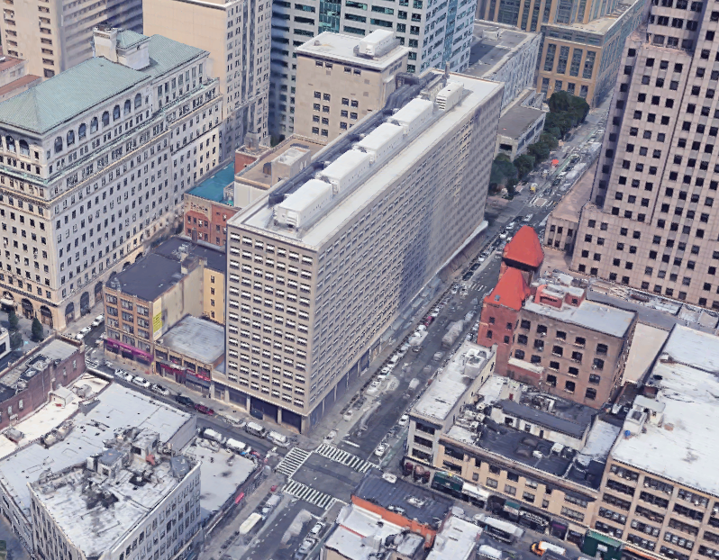

# Bio

## Tl;dr

I was in the legal-investigative world in NYC for several years before I made the switch to data engineering/analysis/science. It was definitely the right call...

## The longer version

I got a degree in Philosophy from Davidson College in 2010 (where I was, sadly, not part of Steph Curry's inner circle), spent a year in China teaching English, and then moved to NYC. After a few odd jobs, I landed a job at the [Manhattan DA's Office](https://www.manhattanda.org/district-attorney-vance-announces-expansion-anti-corruption-unit/) investigating city officials suspected of public corruption. Then I moved over to a small [PI firm](https://www.questinvestigates.com/) as an investigator where we did background checks, interviewed witnesses, and read lots of court cases. Finally, I moved back to the public sector as an auditor for the [NYC Campaign Finance Board](https://www.nyccfb.info/).

During that last one (auditing), I started to make the switch from qualitative to quantitative analysis. In my spare time, I learned Python and SQL before deciding to go full time at an applied data science masters program at [NYU](https://cusp.nyu.edu/) in Summer 2018. 

Since then, I've stayed on the data engineering path and have worked in different domains, from retail site selection to clean energy. I've even found a way to blend it together with tennis(!) in a side project I have called [Bageled NYC](https://bageled.nyc/).

Having lived in NYC since 2011, it's the place I call home. If you wanna say hi, you can probably find me near a tennis court or working a shift at the Park Slope Food Coop. <a href="mailto: hi@samhburns.com">Email also works.</a>
