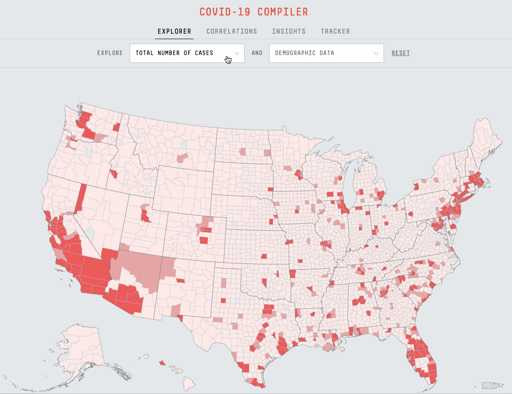

<h1>Intro</h1>

I'm a data engineer, energy nerd, and founder of a small (but fun!) [tennis brand](https://bageled.nyc/). I've built data pipelines, managed software teams, read [over a dozen books](https://www.goodreads.com/list/show/414443.History_of_energy) on the history of energy (my neice still makes fun of me for reading about the [history of coal mining in Europe](https://www.goodreads.com/book/show/204557935-the-age-of-coal)), led local fundraising for a [local non-profit](https://www.fortgreenetennis.org/), and designed products that found their way [into New York Magazine](https://bageled.nyc/Press). By day, I'm embedded within the energy industry as a software engineer. At nights and on weekends, I continue to build out the aforementioned tennis brand. You could say that I'm a firm believer in being truly interested in my work and in having fun side projects.

Here's a bit more about my work as a data engineer and how I arrived at the energy industry.

If you're more interested in the tennis side of things, <a href="./tennis">here's my story</a>.

I like Python, SQL, and maps. I've worked with all kinds of data and worked with teams building different types of applications, like this COVID-19 tracker, for example:

 
 

But I'm also in a long-term, committed relationship with tennis and I've <a href="./tennis">found ways</a> to combine that with data, including in my role as the co-creator behind [Bageled NYC](https://bageled.nyc/).

 
 
<h2>The organizational half</h2>

Along with data engineering and analysis, I was also a board member at [a non-profit in Brooklyn](https://www.fortgreenetennis.org/) from 2015 to 2023, where I was focused on organizing volunteers to support our local community tennis courts. More on that <a href="./bio">here</a>...