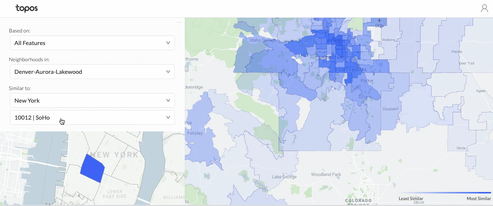
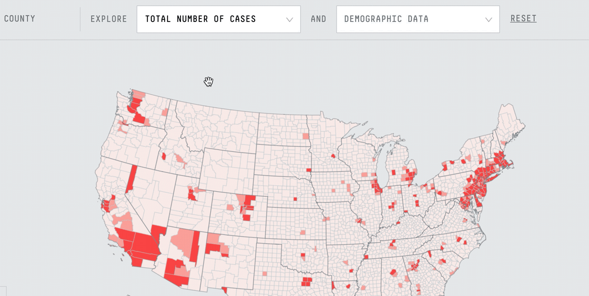
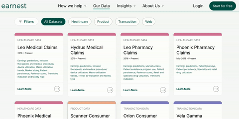
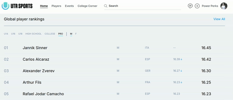
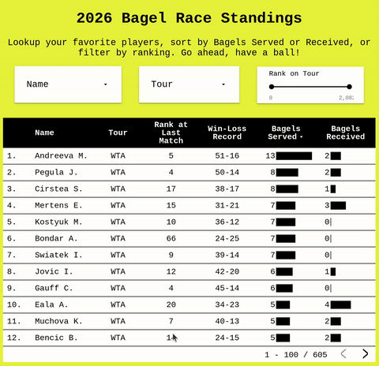
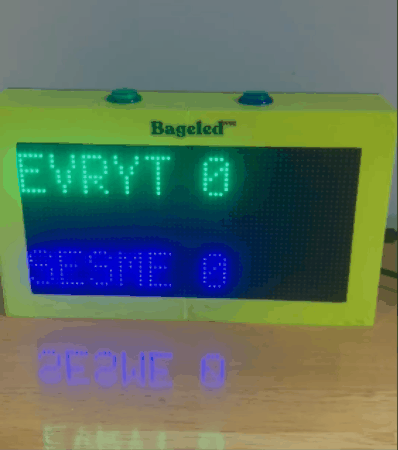
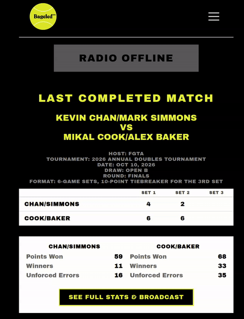

<h1>Data engineering</h1>

I'm currently a Senior Software Engineer at [Catalyst Power](https://catalystpower.com/). We sell power to commercial and industrial customers, help them transition to renewable energy sources, and operate our own power generation. I make sure that the data supplying those business lines is accurate and up-to-date.

It's been a winding road to get here. But the energy world is what I've been looking for in many ways and I'm excited to be working in it. Here's a bit more background on how I got here...

<h2>hello world</h2>

In 2017, I started learning some basic Python programming. I liked it enough to decide to go to NYU for a masters program in [applied data science](https://engineering.nyu.edu/research/centers/cusp), where I developed a working competency in [data engineering and data science](https://github.com/seeess1/machineLearning/blob/master/README.md) practices. I finished my grad degree in 2019 and landed a data engineering opportunity at a Brooklyn-based startup called [Topos](https://topos.com/), where we worked with retailers to help them find new locations to open up shop. We provided them with mapping tools to help them understand neighborhoods in other cities so they could answer questions like "what's the Soho of Boston?":
 
 

  
  

    X
    

      
    

  

 
As a data engineer, my job was to build out the underlying geospatial metrics that fed our maps, which incorporated demographic, foot traffic, vehicular traffic, and business location datasets. But when COVID-19 began to spread, and retail activity slowed to a halt, we decided to apply our map-making skills to build a COVID-19 tracker, which allowed researchers, healthcare workers, and general users to explore different ways to understand the epidemic:

  
  

    X
    

      
    

  

 

<h2>Transition</h2>

Topos, sadly, wasn't able to make it out of the COVID-19 epidemic and had to close its doors. But I took the real-world engineering experience I gained there and built upon it as a data engineer at [Earnest Research](https://www.earnestanalytics.com/), creating data products for investors from large-scale mobile location, retail, and healthcare claims data:

  
  

    X
    

      
    

  

 

All the while, I continued to be <a href="./tennis">involved in the tennis world</a>, and an opportunity came along that combined my software experience with my lifelong passion for tennis. I took on the role as data engineer at [UTR Sports](www.utrsports.net), a racket sports ratings and events platform used across the globe. I worked closely with their data science team to continue to improve on the ratings system (the bedrock of the company's products) and ended up managing the data engineering team and leading our projects.

  
  

    X
    

      
    

  

 

<h2>But what about energy?</h2>

Starting around 2023, as news outlets started talking more about interconnection queues, electrification, and data center construction, I realized I needed to learn more about that thing called "the grid". What began with [a history](https://mitpress.mit.edu/9780262640305/electrifying-america/) of the political, cultural, and societal impacts of the invention of the grid led to a [borderline obsession](https://www.goodreads.com/list/show/414443.History_of_energy) with understanding the energy systems that have sustained human society since the first industrial revolution.

As my studies progressed, I saw an opportunity to combine my intellectual interests in energy systems with my background as a software engineer, first, by volunteering my time with a climate advocacy thinktank called [Switchbox](https://www.switch.box/) and, now, as a Senior Software Engineer at [Catalyst Power](https://catalystpower.com/). 

## A special note on tennis

My lifelong passion for tennis has also spawned a few software and hardware projects along the way, like [a fun leaderboard](https://bageled.nyc/bagel-race) showing which pro tennis players have the most bagels on tour...

  
  

    X
    

      
    

  

 

...a personal scoreboard that I [designed and 3D-printed](https://bageled.nyc/DIY-scoreboard)...

  
  

    X
    

      
    

  

 

...and my latest project, which is an [online radio show](https://radio.bageled.nyc/) where we commentate on local, recreational tennis tournaments and provide real-time scores and stats:

  
  

    X
    

      
    

  

 
