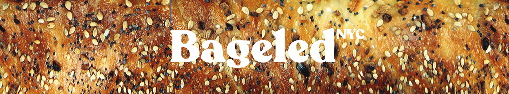
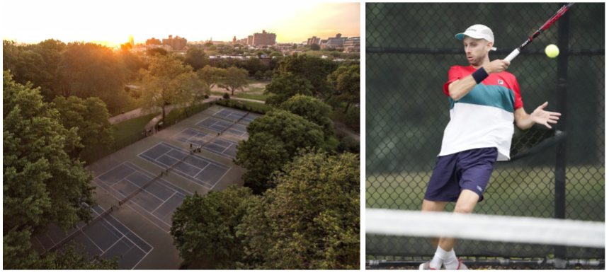

# Tennis

I'm a lifelong tennis player and have stayed active in the game as a player, former Data Engineer at [Universal Tennis](https://www.universaltennis.com/), community organizer at the [Fort Greene Tennis Association](http://www.fortgreenetennis.org/), and through a side business called [Bageled NYC](https://bageled.nyc/).

## Bageled NYC

  
  

    X
    

      
    

  

I'm working with a creative partner on a project called [Bageled NYC](https://www.bageled.nyc/), where we create bagel-inspired tennis merch, run events, and create content (in tennis, a score of 6-0 is also called a "bagel"). I've worked on everything from illustration to production sourcing to social media. And we've been lucky enough to be [featured in New York Magazine's The Strategist](https://bageled.nyc/Press) along with other outlets. It's been a fun ride!

## Fort Greene Tennis Association

  
  

    X
    

      
    

  

 

The [Fort Greene Tennis Association](https://www.fortgreenetennis.org/) (aka "FGTA") is a Brooklyn-based non-profit that runs tournaments and events and raises money to maintain the tennis courts at Fort Greene Park. From 2015 to 2023, I volunteered as a board member at FGTA, where I:

- Served as President and later as Director of Fundraising.
- Led a fundraising drive in which we raised $70k and resurfaced all 6 tennis courts in 2019.
- Collected and analyzed data to better understand the tennis community.
- And helped to put on events for hundreds of people (among many other things).

FGTA became a [nationally-recognized organization](https://www.usta.com/en/home/stay-current/national/fort-greene-park-tennis-hotbed-highlights-growth-of-recreational.html) and I'm really glad I got to be a part of it.
